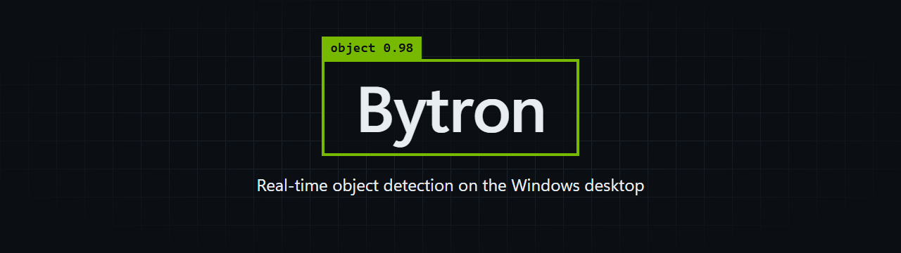
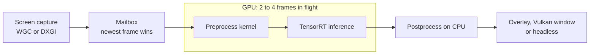

<p align="center">
  
</p>

<p align="center">
  <a href="https://github.com/CobraAitch/Bytron-Cuda/actions/workflows/ci.yml"></a>
  <a href="LICENSE"></a>
  
  
  
  
</p>

Bytron runs a YOLO26 detector on whatever is on your screen and draws the results back on top of it. It captures the desktop, runs each frame through TensorRT on your NVIDIA GPU, and shows the boxes on a transparent, click-through overlay.

Frames stay in GPU memory from capture to inference. Only the detection results are copied back to the CPU.

## Features

- **Two capture backends.** Windows.Graphics.Capture by default, with automatic fallback to DXGI Desktop Duplication.
- **Pipelined inference.** Two to four frames run at once, each on its own CUDA stream and TensorRT context.
- **Newest frame wins.** When the GPU is busy, stale captures are dropped instead of queued, so the boxes follow what is on screen now.
- **One preprocessing kernel.** Resize, letterbox, color conversion, normalization and layout change all happen in a single CUDA pass.
- **CUDA graph replay.** After a warm-up pass, the GPU work for a frame launches as one captured graph.
- **Three outputs.** A transparent overlay, a full-frame Vulkan window, or headless.
- **FP16 or INT8.** INT8 uses entropy calibration on your own images.
- **Configurable output layout.** A small schema maps tensor fields to box corners, confidence and class, so other NMS-free models can be used without code changes.

## How it works



A capture thread keeps a three-entry mailbox filled with the latest frames. An inference thread cycles through pipeline slots, and each slot owns the GPU resources for one frame. The [architecture notes](docs/architecture.md) cover threading, synchronization and graph capture in detail.

## Requirements

| Component | Version |
| --- | --- |
| Operating system | Windows 11 |
| GPU | NVIDIA, built for SM 8.9 (such as RTX 4070 Ti) and SM 12.0 (such as RTX 5070) |
| Compiler | Visual Studio 2026 with the v145 toolset |
| CMake | 4.2 or newer |
| CUDA Toolkit | 13.1 |
| TensorRT | 10.15 |
| Vulkan SDK | 1.4 |
| Package manager | [vcpkg](https://github.com/microsoft/vcpkg) |

To target another GPU architecture, add it to `BYTRON_CUDA_ARCHS` in [CMakeLists.txt](CMakeLists.txt).

## Build

Point the build at vcpkg and at your TensorRT folder, which should contain `include`, `lib` and `bin`. Then use the release preset. vcpkg fetches the remaining dependencies during configure.

```powershell
git clone https://github.com/CobraAitch/Bytron-Cuda.git
cd Bytron-Cuda

$env:VCPKG_ROOT    = "C:\path\to\vcpkg"
$env:TENSORRT_ROOT = "C:\path\to\TensorRT"

cmake --preset x64-release
cmake --build --preset x64-release
```

The binary lands in `out\x64-release\Release`, with the TensorRT DLLs copied next to it.

The presets expect CUDA 13.1 in its default install folder. To use another toolkit or Visual Studio version, add your own preset in `CMakeUserPresets.json`, which git ignores.

## Get a model

Bytron does not ship a model. Export one with [Ultralytics](https://docs.ultralytics.com/models/yolo26/):

```python
from ultralytics import YOLO

YOLO("yolo26m.pt").export(format="onnx", nms=False)
```

`nms=False` matters. It selects the NMS-free head, which outputs `[1, 300, 6]` with one `x1, y1, x2, y2, confidence, class_id` row per detection. The default export uses the one-to-many head, which Bytron cannot decode.

## Run

```powershell
# Transparent overlay on the primary monitor
.\out\x64-release\Release\bytron.exe --onnx yolo26m.onnx

# Second monitor with a stricter confidence threshold
.\out\x64-release\Release\bytron.exe --onnx yolo26m.onnx --monitor 1 --conf 0.4

# Full-frame Vulkan window instead of the overlay
.\out\x64-release\Release\bytron.exe --onnx yolo26m.onnx --no-overlay

# No window, timing logs only
.\out\x64-release\Release\bytron.exe --onnx yolo26m.onnx --no-display
```

The first run builds a TensorRT engine from the ONNX file, which can take several minutes. The engine is cached in `models\`, so later starts are quick. Press Ctrl+C to stop.

| Option | Default | Description |
| --- | --- | --- |
| `-m`, `--onnx <path>` | required | Path to the ONNX model |
| `-c`, `--config <path>` | | JSON config file. Other flags override it |
| `-g`, `--gpu <index>` | `0` | CUDA device index |
| `-d`, `--monitor <index>` | `0` | Monitor to capture |
| `-p`, `--precision <fp16\|int8>` | `fp16` | Inference precision |
| `--conf <float>` | `0.25` | Confidence threshold |
| `--slots <n>` | `3` | Frames in flight, from 2 to 4 |
| `--capture <wgc\|dxgi>` | `wgc` | Capture backend |
| `--calibration-dir <dir>` | | Images for INT8 calibration |
| `--calibration-batch <n>` | `8` | INT8 calibration batch size |
| `--no-overlay` | | Use the full-frame Vulkan window |
| `--no-display` | | Run without a window |
| `--no-cuda-graphs` | | Launch every frame eagerly |

For a config file, start from [config.example.json](config.example.json). The [configuration reference](docs/configuration.md) lists every key.

## Tests and benchmarks

The `ci` preset builds only the CPU-side tests and benchmarks. It needs Visual Studio and vcpkg, but no GPU, CUDA or TensorRT.

```powershell
cmake --preset ci
cmake --build --preset ci
ctest --preset ci
.\out\ci\Release\bytron_bench.exe
```

The per-frame CPU work is small. These numbers come from a Release build on an Intel Core i9-14900KF.

| Benchmark | Time per call |
| --- | --- |
| `compute_letterbox` | 1.8 ns |
| `Postprocessor::process`, 300 detections | 245 ns |

At runtime, Bytron logs FPS and mean GPU latency every 100 frames. Run with `--no-cuda-graphs` to see a per-stage split for preprocessing, inference and the copy back to the host.

## Project layout

```text
include/bytron/   Public types
src/capture/      WGC and DXGI capture backends
src/core/         Pipeline, slots, mailbox and RAII wrappers for CUDA objects
src/engine/       TensorRT engine build, cache and INT8 calibration
src/preprocess/   CUDA preprocessing kernel and letterbox math
src/postprocess/  Confidence filter and inverse letterbox
src/output/       Overlay, Vulkan display and callback sinks
src/util/         Config, logging and timers
tests/            GoogleTest unit tests
benchmarks/       CPU micro-benchmarks
```

## Contributing

Bug reports and pull requests are welcome. See [CONTRIBUTING.md](CONTRIBUTING.md) for the workflow, and [SECURITY.md](SECURITY.md) for reporting vulnerabilities.

## License

Bytron is released under the [MIT License](LICENSE).

Models and SDKs keep their own terms:

- YOLO26 is published by Ultralytics under [AGPL-3.0 or an Enterprise license](https://docs.ultralytics.com/models/yolo26/). Check those terms before you ship a model with Bytron.
- CUDA and TensorRT are covered by NVIDIA's [license agreements](https://docs.nvidia.com/deeplearning/tensorrt/sla/).
- [stb_image](https://github.com/nothings/stb) is vendored in `include/stb` under its own public domain or MIT terms.

NVIDIA, CUDA and TensorRT are trademarks of NVIDIA Corporation. Bytron is an independent project and is not affiliated with NVIDIA or Ultralytics.
