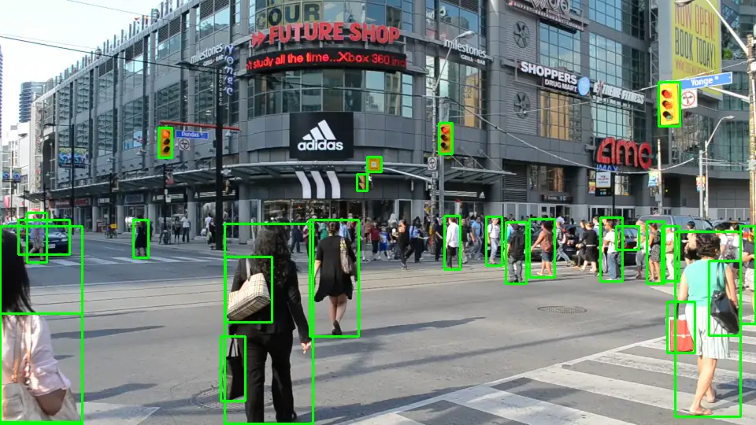
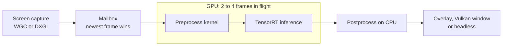

<h1 align="center">Bytron</h1>

<p align="center">
  <b>Real-time object detection on the Windows desktop.</b><br>
  YOLO26 through TensorRT, with frames staying on the GPU from capture to inference.
</p>

<p align="center">
  <a href="https://github.com/CobraAitch/Bytron-Cuda/actions/workflows/ci.yml"></a>
  <a href="https://github.com/CobraAitch/Bytron-Cuda/actions/workflows/codeql.yml"></a>
  <a href="LICENSE"></a>
</p>

<p align="center">
  <a href="docs/architecture.md">Architecture</a> &nbsp;&middot;&nbsp;
  <a href="docs/benchmarks.md">Benchmarks</a> &nbsp;&middot;&nbsp;
  <a href="docs/configuration.md">Configuration</a> &nbsp;&middot;&nbsp;
  <a href="docs/troubleshooting.md">Troubleshooting</a> &nbsp;&middot;&nbsp;
  <a href="CHANGELOG.md">Changelog</a>
</p>

<p align="center">
  
</p>

<p align="center"><sub>
  Screen recording of the Bytron overlay running live at 238 fps on an RTX 4070 Ti. The shipped overlay is hidden from screen capture, so this take used a build with that exclusion turned off. Footage: Raysonho, CC0, via Wikimedia Commons.
</sub></p>

## Why Bytron

A typical Python loop copies every frame to the CPU, preprocesses it there, and sends it back to the GPU. Bytron skips those round trips. Frames stay in GPU memory, preprocessing runs in one CUDA kernel, and inference is replayed as a captured graph.

| Same model, same GPU | Time per frame |
| --- | ---: |
| **Bytron** | **1.65 ms** |
| ONNX Runtime with TensorRT | 6.47 ms |
| ONNX Runtime with CUDA | 9.99 ms |
| ONNX Runtime on CPU | 110.76 ms |

That is about 4 times less time per frame than ONNX Runtime's TensorRT provider, and about 6 times less than its CUDA provider, on `yolo26m` at 640x640 on an RTX 4070 Ti. The ONNX Runtime figures leave out capture entirely, which favors them.

See the [benchmark report](docs/benchmarks.md) for the method, raw data and limitations.

## How it works



A capture thread keeps a three-entry mailbox filled with the latest frames. An inference thread cycles through pipeline slots, and each slot owns the GPU resources for one frame. When the GPU is busy, stale captures are dropped instead of queued, so the boxes follow what is on screen now. The [architecture notes](docs/architecture.md) cover threading, synchronization and graph capture.

## Features

- **Two capture backends.** Windows.Graphics.Capture by default, with automatic fallback to DXGI Desktop Duplication.
- **Pipelined inference.** Two to four frames run at once, each on its own CUDA stream and TensorRT context.
- **Three outputs.** A transparent click-through overlay, a full-frame Vulkan window, or headless.
- **FP16 or INT8.** INT8 uses entropy calibration on your own images.
- **Configurable output layout.** A small schema maps tensor fields to box corners, confidence and class, so other NMS-free models work without code changes.

## Requirements

| Component | Version |
| --- | --- |
| Operating system | Windows 11 |
| GPU | NVIDIA, built for SM 8.9 (such as RTX 4070 Ti) and SM 12.0 (such as RTX 5070) |
| Compiler | Visual Studio 2026 with the v145 toolset |
| CMake | 4.2 or newer |
| CUDA Toolkit | 13.1 |
| TensorRT | 10.15 |
| Vulkan SDK | 1.4 |
| Package manager | [vcpkg](https://github.com/microsoft/vcpkg) |

To target another GPU architecture, add it to `BYTRON_CUDA_ARCHS` in [CMakeLists.txt](CMakeLists.txt).

## Build

Point the build at vcpkg and at your TensorRT folder, which should contain `include`, `lib` and `bin`. vcpkg fetches the remaining dependencies during configure.

```powershell
git clone https://github.com/CobraAitch/Bytron-Cuda.git
cd Bytron-Cuda

$env:VCPKG_ROOT    = "C:\path\to\vcpkg"
$env:TENSORRT_ROOT = "C:\path\to\TensorRT"

cmake --preset x64-release
cmake --build --preset x64-release
```

The presets expect CUDA 13.1 in its default install folder. To use another toolkit or Visual Studio version, add your own preset in `CMakeUserPresets.json`, which git ignores.

## Get a model

Bytron does not ship a model. Export one with [Ultralytics](https://docs.ultralytics.com/models/yolo26/):

```python
from ultralytics import YOLO

YOLO("yolo26m.pt").export(format="onnx", nms=False)
```

`nms=False` matters. It selects the NMS-free head, which outputs `[1, 300, 6]` with one `x1, y1, x2, y2, confidence, class_id` row per detection. The default export uses the one-to-many head, which Bytron cannot decode.

## Run

```powershell
# Transparent overlay on the primary monitor
.\out\x64-release\Release\bytron.exe --onnx yolo26m.onnx

# High refresh display, with a stricter confidence threshold
.\out\x64-release\Release\bytron.exe --onnx yolo26m.onnx --capture dxgi --conf 0.4

# Full-frame Vulkan window instead of the overlay
.\out\x64-release\Release\bytron.exe --onnx yolo26m.onnx --no-overlay

# No window, timing logs only
.\out\x64-release\Release\bytron.exe --onnx yolo26m.onnx --no-display
```

The first run builds a TensorRT engine from the ONNX file, which can take several minutes. The engine is cached in `models\`, so later starts are quick. Press Ctrl+C to stop.

| Option | Default | Description |
| --- | --- | --- |
| `-m`, `--onnx <path>` | required | Path to the ONNX model |
| `-c`, `--config <path>` | | JSON config file. Other flags override it |
| `-g`, `--gpu <index>` | `0` | CUDA device index |
| `-d`, `--monitor <index>` | `0` | Monitor to capture |
| `-p`, `--precision <fp16\|int8>` | `fp16` | Inference precision |
| `--conf <float>` | `0.25` | Confidence threshold |
| `--slots <n>` | `3` | Frames in flight, from 2 to 4 |
| `--capture <wgc\|dxgi>` | `wgc` | Capture backend |
| `--calibration-dir <dir>` | | Images for INT8 calibration |
| `--calibration-batch <n>` | `8` | INT8 calibration batch size |
| `--no-overlay` | | Use the full-frame Vulkan window |
| `--no-display` | | Run without a window |
| `--no-cuda-graphs` | | Launch every frame eagerly |

For a config file, start from [config.example.json](config.example.json). The [configuration reference](docs/configuration.md) lists every key.

## Known limitations

- Windows only, and one monitor per process.
- Capture buffers are sized for 3840 by 2160.
- Boxes are drawn without class names.
- Windows.Graphics.Capture delivered 60 fps on a 240 Hz display in testing, so use `--capture dxgi` on high refresh displays.
- DXGI counts cursor-only updates as frames.
- End-to-end latency from screen to overlay has not been measured.

## Development

The `ci` preset builds the CPU-side tests and benchmarks. It needs Visual Studio and vcpkg, but no GPU, CUDA or TensorRT.

```powershell
cmake --preset ci
cmake --build --preset ci
ctest --preset ci
```

See [CONTRIBUTING.md](CONTRIBUTING.md) for the workflow, and [SECURITY.md](SECURITY.md) for reporting vulnerabilities.

## License

Bytron is released under the [MIT License](LICENSE).

Models and SDKs keep their own terms:

- YOLO26 is published by Ultralytics under [AGPL-3.0 or an Enterprise license](https://docs.ultralytics.com/models/yolo26/). Check those terms before you ship a model with Bytron.
- CUDA and TensorRT are covered by NVIDIA's [license agreements](https://docs.nvidia.com/deeplearning/tensorrt/sla/).
- [stb_image](https://github.com/nothings/stb) is vendored in `include/stb` under its own public domain or MIT terms.

NVIDIA, CUDA and TensorRT are trademarks of NVIDIA Corporation. Bytron is an independent project and is not affiliated with NVIDIA or Ultralytics.
