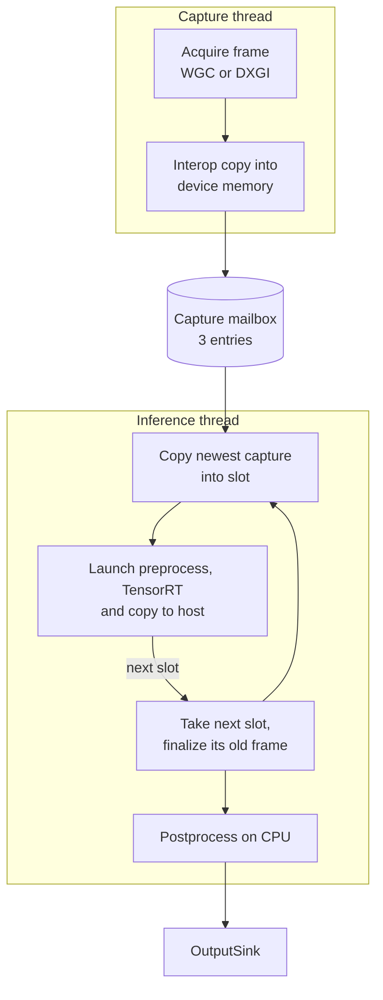

# Architecture

Bytron is built around one goal: show detections for what is on screen now, not for what was on screen a few frames ago. Most design choices below follow from that.


## Threads and data flow



| Thread | Priority | Job |
| --- | --- | --- |
| Capture | Highest | Pulls frames from the capture backend into the mailbox |
| Inference | Highest | Runs the slot loop and delivers results to the sink |
| Display | Normal | Owned by the overlay and Vulkan sinks. Draws and presents |

The process also runs in the high priority class. Threads block on events and condition variables between frames, so this removes scheduling jitter without starving the system.

## Capture

Both backends implement `ICaptureSource` and deliver BGRA frames into a CUDA device buffer. The frame goes from a D3D11 texture through a CUDA-registered staging texture and into device memory, with no trip through host memory.

| Backend | Flag | Notes |
| --- | --- | --- |
| Windows.Graphics.Capture | `--capture wgc` | Default. No capture border or cursor where the OS allows it |
| DXGI Desktop Duplication | `--capture dxgi` | Used automatically if WGC fails to start |

If capture is lost, for example on a display mode change, the capture thread retries every 100 ms, up to 20 times. If that fails, the pipeline shuts down and reports the error.

## The capture mailbox

The mailbox hands frames from the capture thread to the inference thread. It has three entries, and the inference thread always takes the newest one. Frames that nobody reads are simply overwritten.

This is a deliberate choice. A queue would preserve every frame, but under load it would also preserve the delay. Dropping old frames keeps latency bounded.

## Pipeline slots

A slot owns everything one frame needs: a high-priority CUDA stream, a TensorRT execution context, and its own device and pinned buffers. With N slots, up to N frames are in flight.

The inference thread walks the slots in order. For each one it:

1. Finalizes the frame already in that slot, if any. This waits for the GPU, postprocesses the results and delivers them to the sink.
2. Takes the newest capture from the mailbox. It does this after the wait, so frames that arrived during the wait are not missed.
3. Copies the capture into the slot and launches preprocessing, inference and the copy back to the host.

The thread only blocks on the GPU when the oldest frame is still running. More slots raise throughput, because the GPU is never idle waiting for the CPU. They also add latency, because each frame waits longer in line. The default of three is a balance between the two, and the pipeline clamps the value to the range 2 to 4. Slots only matter when frames overlap. In the [benchmarks](benchmarks.md), mean GPU time stayed far below the frame interval, and the slot count made no measurable difference.

## Preprocessing

One CUDA kernel does bilinear resize, letterbox padding, BGRA to RGB, normalization to `[0, 1]` and the HWC to CHW transpose. Fusing these into one pass avoids intermediate buffers and repeated kernel launches. Padding uses the 114/255 gray that YOLO models are trained with.

## CUDA graphs

A frame's GPU work spans many kernels, so launching it eagerly has real CPU overhead. Bytron captures the sequence into a CUDA graph instead, then replays it with a single launch.

Under load this saved about a third of the GPU time in the [benchmarks](benchmarks.md), and the benefit was smaller at low frame rates.

Each slot runs one eager pass first, which lets TensorRT finish auto-tuning its kernels. The graph is captured after that. Graphs depend on the source dimensions, so each slot caches them per resolution with LRU eviction, up to four entries.

TensorRT's auxiliary streams need special handling. Capture runs in relaxed mode, and each auxiliary stream is explicitly forked from the capture stream and joined back into it, so those kernels land in the graph.

Graph replay fuses the stages into one launch, so per-stage timings are only available from eager frames. Use `--no-cuda-graphs` to get them on every frame.

## TensorRT engine

Building an engine from ONNX is slow, so the result is serialized to `engine_cache_dir`, named after the model and precision. A `.timing` file next to it speeds up later builds.

An engine only works with the GPU architecture and TensorRT version that built it. After changing either, delete the cached `.engine` file to rebuild it.

## Postprocessing

The model is NMS-free, so postprocessing only filters and rescales. It drops detections below the confidence threshold and maps the rest from model space back to source pixels:

```text
src_coord = (model_coord - pad) / scale
```

`DetectionSchema` tells the postprocessor which tensor index holds each field. The maximum detection count and the row width both come from the model's output shape.

## Output sinks

Results reach the outside world through `OutputSink`. The pipeline calls `on_frame()` on the inference thread, so sinks must not block it.

| Sink | Selected by | Behavior |
| --- | --- | --- |
| `OverlaySink` | default | Draws boxes on the CPU into a click-through layered window. Discards the GPU frame |
| `DisplaySink` | `--no-overlay` | Copies the frame, draws boxes with a CUDA kernel, and presents through Vulkan interop |
| `CallbackSink` | `--no-display` | Passes detection metadata to a callback |

The overlay is excluded from screen capture with `WDA_EXCLUDEFROMCAPTURE`. Without that, Bytron would detect its own boxes. It also redraws only the regions that changed, so its cost follows box area instead of monitor area.

## Synchronization

GPU ordering uses CUDA events. CPU state uses a mutex and condition variable.

| Signal | Recorded on | Waited on by | Guarantees |
| --- | --- | --- | --- |
| `capture_done` | Capture stream | Slot stream | The frame is fully written before it is read |
| `read_done` | Slot stream | Capture stream | An entry is not overwritten during a read |
| `ready_event` | Slot stream | Inference thread | Results are in the pinned host buffer |
| `display_copy_done` | Sink | Slot stream | The slot's frame buffer is not reused during a sink copy |

The mailbox mutex guards the latest index, the sequence counter and each entry's dimensions, so the inference thread never sees a half-updated frame size.

Exceptions on worker threads are stored and rethrown from `Pipeline::run()`, so a failure on either thread surfaces in `main()`.

## Extending Bytron

- **New output.** Subclass `OutputSink` in `src/output/`, and record `copy_done_event` when you finish with the device frame.
- **New capture source.** Implement `ICaptureSource`, and add it to `make_capture_source()`.
- **Different model output.** Set `detection_schema` in the config if your model has the same row-based shape with a different field order.
